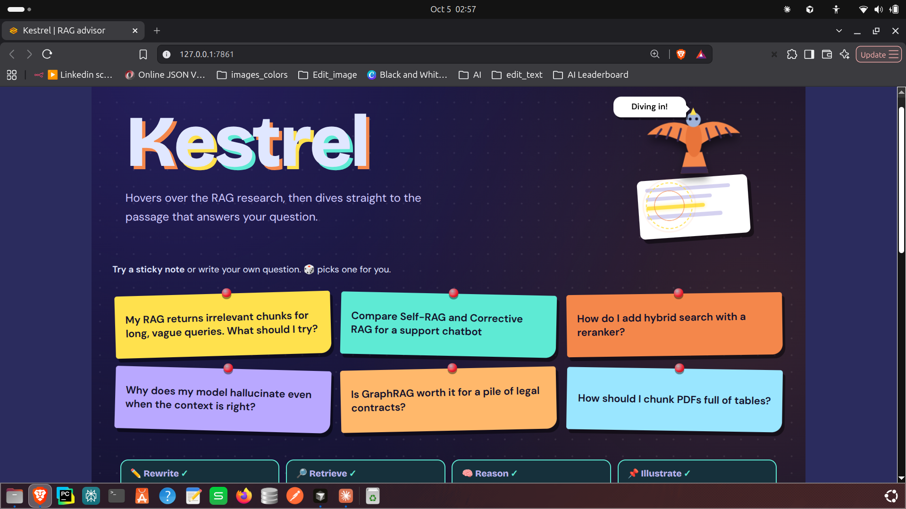
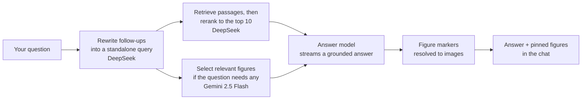

# Kestrel 🦅

   ---
   title: Kestrel
   emoji: 🦅
   sdk: gradio
   sdk_version: 5.x.x
   app_file: app.py
   ---

**A research-grounded advisor for Retrieval-Augmented Generation.**
Describe a RAG problem, compare techniques, or ask how to implement a strategy. Kestrel hovers over a library of RAG papers, then dives to the passages (and figures) that answer you, with sources.

[**Try the live demo**](TODO-your-hugging-face-space-url) · [Watch the 30s demo](#demo)



## What it does

- **Diagnoses RAG problems.** "My RAG returns irrelevant chunks for vague queries" gets a diagnosis, why it happens, and strategies to try.
- **Adapts to your intent.** Troubleshooting, recommendations, optimization, comparisons, implementation and conceptual questions each get a different answer structure.
- **Stays grounded.** Answers are based on retrieved paper excerpts, and the model separates established evidence from its own engineering suggestions.
- **Shows the figures.** When an architecture diagram or results chart helps, the answer pins the original figure from the paper right in the chat.
- **Handles follow-ups.** Short follow-ups like "how does that compare?" are rewritten into standalone search queries.

## How it works



1. **Rewrite.** For follow-up messages, a small, fast model (DeepSeek, the same one used for reranking) turns the latest message into a standalone query. The first message is used as is.
2. **Retrieve and rerank.** `retrieve_context(query)` finds candidate passages, and DeepSeek reranks them down to the 10 best.
3. **Select figures.** Gemini 2.5 Flash picks up to 5 figures (each with a caption and an id) that are relevant to the question, and none when the question doesn't need a visual.
4. **Answer.** The answer model gets the passages and the figure list, and streams its response.
5. **Pin figures.** The answer model shows a figure by writing `[[figure:<id>]]` where it belongs. The app strips the markers, drops any invented ids, and renders the chosen figures in the chat.

## Design decisions

- **Two-stage figure selection.** A small, cheap model (Gemini 2.5 Flash) shortlists figures only when a question calls for one. The answer model then decides which of the shortlisted figures actually help and where they belong, so images appear right next to the text they support.
- **Unknown ids are dropped silently.** If the model invents a figure id, it is ignored rather than breaking the answer.
- **Streaming with live status.** The UI shows each pipeline stage (Rewrite, Retrieve, Reason, Illustrate) as it runs, plus passage count, figure count and response time.
- **Evidence over confidence.** The system prompt tells the model to mark which parts come from the research and which are its own suggestions.

## Tech stack

Python · Gradio · LiteLLM · DeepSeek · Gemini 2.5 Flash · TODO: vector store · TODO: embedding model · [uv](https://docs.astral.sh/uv/)

| Role | Model |
|---|---|
| Query rewriting | DeepSeek (same fast model as the reranker) |
| Reranking | DeepSeek |
| Figure selection | Gemini 2.5 Flash |
| Answer generation | `openrouter/openai/gpt-oss-120b` by default |

Models are called through LiteLLM, and the answer model can be swapped by changing one environment variable.

## Getting started

```bash
git clone https://github.com/TODO-your-username/TODO-repo-name.git
cd TODO-repo-name
uv sync

cp .env.example .env     # then add your API key(s)
```

Build the index (first time only):

```bash
# TODO: replace with your ingestion command(s), for example:
# uv run python -m src.ingestion.<your_ingestion_script>
```

Run the app:

```bash
uv run python app.py
```

Then open the local URL that Gradio prints (usually http://127.0.0.1:7860).

### Configuration

| Variable | Purpose | Default |
|---|---|---|
| `OPENROUTER_API_KEY` | API key for the answer model (via OpenRouter) | none |
| `RAG_DOCTOR_MODEL` | Answer model, in LiteLLM format | `openrouter/openai/gpt-oss-120b` |
| `RAG_DOCTOR_IMAGES_DIR` | Folder holding the extracted figure images | `data/images` |

## Project structure

<!-- TODO: adjust to match your repo -->
```
.
├── app.py                # Kestrel UI (Gradio)
├── answer.py             # Retrieval + answer workflow and prompt
├── src/
│   └── ingestion/        # Paper processing, indexing, retrieve_context
├── data/
│   └── images/           # Extracted figures
├── docs/                 # Screenshot and demo assets
├── .env.example
└── README.md
```

## Limitations and next steps

- Answers are only as good as the papers in the index. TODO: number of papers and date range.
- Possible next steps: more papers, a citation panel showing the exact passages used, and user feedback buttons.

## Credits

The knowledge base is built from published research papers on RAG. All papers, text excerpts and figures belong to their original authors and are shown here for educational and portfolio purposes. TODO: list the main papers.
